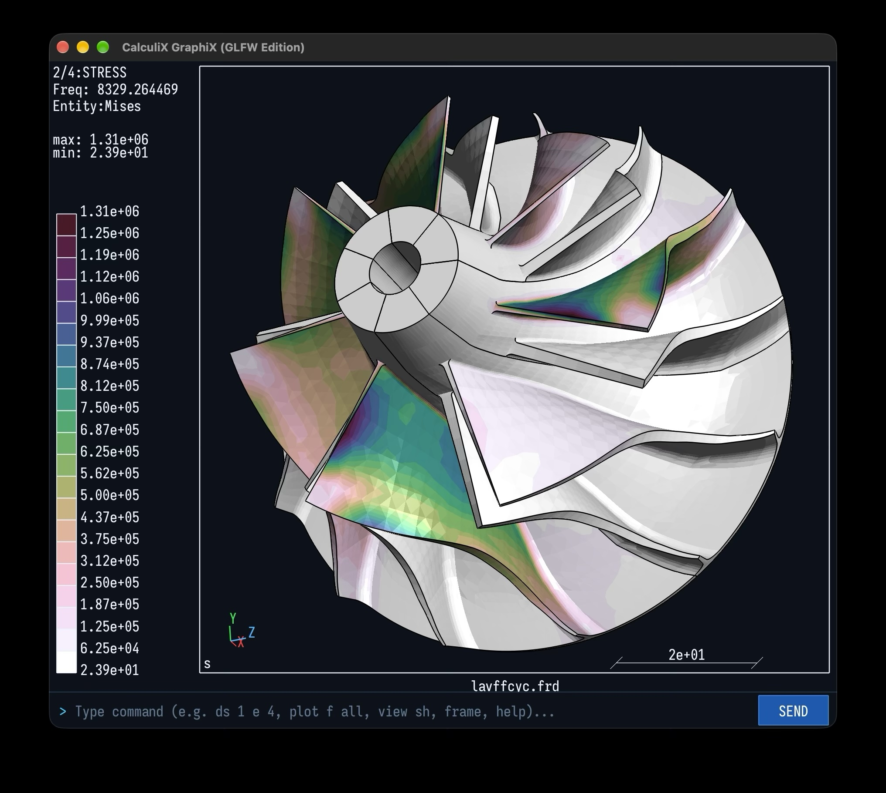

# Compressor Rotor: Prestressed Cyclic-Symmetry Frequency Benchmark

**Model**: 7-blade turbocharger compressor rotor, one cyclic sector
(geometry by Klaus Wittig, from the CalculiX GraphiX examples)
**Analysis**: centrifugal preload (110,000 rpm, `*STATIC`), then prestressed
cyclic-symmetry natural frequencies (`*FREQUENCY`)
**Elements**: `C3D20R` (20-node quadratic hexahedra, reduced integration)

<p align="center">
  
  <br>
  <em>Prestressed vibration stress contour on the 360° expanded rotor, rendered in CalculiX GraphiX (GLFW edition).</em>
</p>

## Files

| File | Content | Origin |
|:---|:---|:---|
| `lavff.fbd` | CGX geometry of one rotor sector | CGX 2.23 `examples/compressor`, unchanged |
| `send.fbl` | CGX batch script that meshes the sector and writes the sets | CGX 2.23 `examples/compressor`, unchanged |
| `lavffcyc.inp` | ccx input deck: centrifugal preload + cyclic frequency step | CGX 2.23 `examples/compressor`, unchanged |
| `remesh.py` | Writes `mesh_<level>.fbl` and runs CGX to produce the mesh at a given level | this repository |
| `rotor.jpg`, `movie_cycle.mp4` | Rendered result and mode animation | this repository |

## Mesh levels

| Level | Elements | Equations | CGX command | Typical memory |
|:---|---:|---:|:---|---:|
| `coarse` | 1,352 | 38,408 | default divisions | < 2 GB |
| `fine` (default) | 10,816 | 283,024 | `div all mult 2` | < 10 GB |

The fine level doubles every division, so the cyclic symmetry boundaries
(`CYC1`, `CYC2`) keep matching node pairs.

```bash
python3 models/compressor_rotor/remesh.py --level fine
```

The runner remeshes automatically when `all.msh`, `CYC1.nam` or `CYC2.nam` is
missing, or when the two cyclic sets have different node counts; `--remesh`
forces it.

## Running

From the repository root:

```bash
python3 runner/run_benchmark.py --case compressor_rotor --level fine --threads 1 2 4 8
```

Published results: [`results/compressor_rotor/`](../../results/compressor_rotor/).

## License and attribution

`lavff.fbd`, `send.fbl` and `lavffcyc.inp` are taken unchanged from the
examples of **CalculiX GraphiX (cgx) 2.23** by **Klaus Wittig**
(`examples/compressor`), part of the CalculiX package by Guido Dhondt and
Klaus Wittig ([calculix.de](http://www.calculix.de)). cgx is distributed under
the GNU General Public License, version 2 or (at your option) any later
version, and these files keep that license:
[GPL-2.0-or-later](../../LICENSES/GPL-2.0.txt). They are **not** covered by
this repository's CC BY 4.0 license.

`remesh.py` (GPL-2.0), the images and this README (CC BY 4.0) are by Carlo
Monjaraz-Tec.
